# Лабораторна робота №2. Створення складних SQL запитів

## Загальна інформація

* **Здобувач освіти:** Гринишин Микола
* **Група:** ІПЗ-32
* **Обраний рівень складності:** Рівень 3 (Високий / Відмінно)
* **СУБД:** PostgreSQL (хмарна платформа Supabase)
* **База даних:** "ТехноМарт" (український інтернет-магазин)

---

## 1. Рівень 1. З'єднання таблиць, агрегація та базові підзапити

### 1.1. З'єднання таблиць (JOIN)

#### 1. INNER JOIN — отримати список товарів з назвами категорій та постачальників

* **Бізнес-логіка:** Поєднання трьох нормалізованих таблиць (`products`, `categories`, `suppliers`) за зовнішніми ключами для отримання повного каталогу товарів із текстовими назвами категорій і постачальників замість числових ID.
* **Оцінка складності та оптимізація:** Складність становить $O(N \log N)$ через фінальне сортування за двома полями. Наявність індексів на `products(category_id)` та `products(supplier_id)` прискорює операції з'єднання.

```sql
SELECT 
    p.product_name AS "Назва товару",
    c.category_name AS "Категорія",
    s.company_name AS "Постачальник",
    p.unit_price AS "Ціна"
FROM products p
INNER JOIN categories c ON p.category_id = c.category_id
INNER JOIN suppliers s ON p.supplier_id = s.supplier_id
ORDER BY c.category_name, p.product_name;
```

* **Результат:** Виведено повний перелік товарів з прив'язкою до їхніх категорій та компаній-постачальників.
* **Скріншот:**

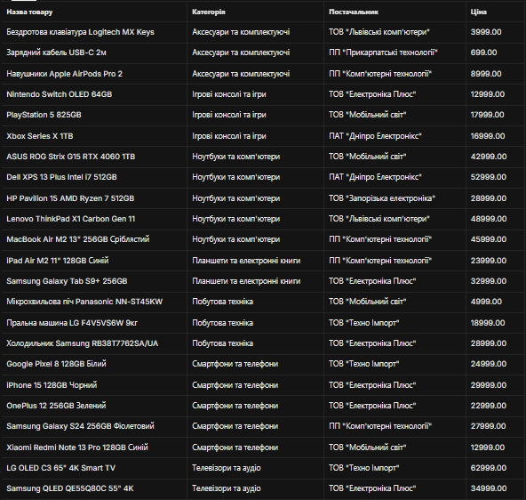

#### 2. LEFT JOIN — отримати всіх клієнтів, включаючи тих, хто не має замовлень

* **Бізнес-логіка:** Збереження всіх записів головної таблиці `customers` (включно з неактивними клієнтами, у яких `0` замовлень) із приєднанням назви регіону та підрахунком загальної кількості замовлень.
* **Оцінка складності та оптимізація:** Використано `COUNT(o.order_id)` замість `COUNT(*)`, щоб для клієнтів без замовлень повертався `0`, а не `1`. Складність: $O(N + M)$.

```sql
SELECT 
    c.contact_name AS "Клієнт",
    c.customer_type AS "Тип клієнта",
    r.region_name AS "Регіон",
    COUNT(o.order_id) AS "Кількість замовлень"
FROM customers c
LEFT JOIN orders o ON c.customer_id = o.customer_id
LEFT JOIN regions r ON c.region_id = r.region_id
GROUP BY c.customer_id, c.contact_name, c.customer_type, r.region_name
ORDER BY "Кількість замовлень" DESC;
```

* **Результат:** Отримано статистику замовлень по всіх 15 клієнтах бази.
* **Скріншот:**

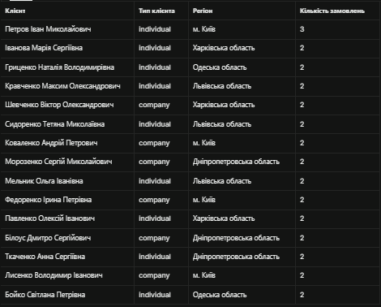

#### 3. Множинне з'єднання (5 таблиць) — детальна інформація про замовлення

* **Бізнес-логіка:** Послідовне поєднання 5 таблиць (`orders`, `customers`, `order_items`, `products`, `categories`) для формування деталізованої звітності за замовленнями з розрахунком суми кожної позиції з урахуванням знижки.
* **Оцінка складності та оптимізація:** При зростанні обсягів замовлень критично важливими є індекси на всі зовнішні ключі (`customer_id`, `order_id`, `product_id`, `category_id`).

```sql
SELECT 
    o.order_id AS "ID замовлення",
    o.order_date AS "Дата",
    cu.contact_name AS "Клієнт",
    c.category_name AS "Категорія",
    p.product_name AS "Товар",
    oi.quantity AS "Кількість",
    ROUND(oi.quantity * oi.unit_price * (1 - oi.discount), 2) AS "Сума позиції"
FROM orders o
INNER JOIN customers cu ON o.customer_id = cu.customer_id
INNER JOIN order_items oi ON o.order_id = oi.order_id
INNER JOIN products p ON oi.product_id = p.product_id
INNER JOIN categories c ON p.category_id = c.category_id
ORDER BY o.order_date DESC, o.order_id
LIMIT 20;
```

* **Результат:** Сформовано зведену таблицю товарних позицій останніх замовлень.
* **Скріншот:**

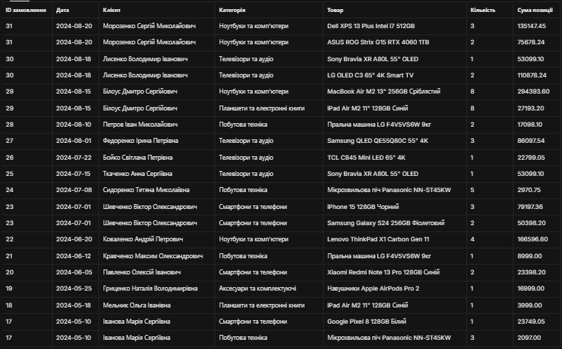

### 1.2. Агрегатні функції

#### 4. Підрахувати кількість товарів у кожній категорії та середню ціну

* **Бізнес-логіка:** Аналіз товарного асортименту та цінового діапазону в кожній категорії (включаючи порожні категорії, у яких наразі `0` товарів).
* **Оцінка складності:** Лінійне сканування з групуванням $O(N)$.

```sql
SELECT 
    c.category_name AS "Категорія",
    COUNT(p.product_id) AS "Кількість товарів",
    ROUND(AVG(p.unit_price), 2) AS "Середня ціна",
    MIN(p.unit_price) AS "Мін. ціна",
    MAX(p.unit_price) AS "Макс. ціна"
FROM categories c
LEFT JOIN products p ON c.category_id = p.category_id
GROUP BY c.category_id, c.category_name
ORDER BY "Кількість товарів" DESC;
```

* **Результат:** Отримано статистичні показники (кількість, середня, мінімальна та максимальна ціна) для всіх 10 категорій.
* **Скріншот:**

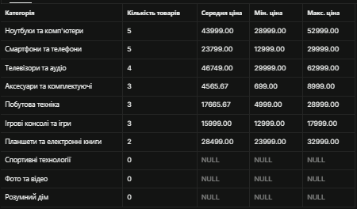

#### 5. Визначити загальні продажі за регіонами (SUM, GROUP BY та HAVING)

* **Бізнес-логіка:** Обчислення загальної виручки доставлених замовлень по регіонах та відбір найприбутковіших регіонів із обсягом продажів понад `50 000` грн.
* **Оптимізація:** Фільтрація `WHERE o.order_status = 'delivered'` виконується до етапу групування (`GROUP BY`), що зменшує кількість рядків для агрегації, а `HAVING` фільтрує вже обчислені суми груп.

```sql
SELECT 
    COALESCE(r.region_name, 'Не вказано') AS "Регіон",
    COUNT(DISTINCT o.order_id) AS "Кількість замовлень",
    ROUND(SUM(oi.quantity * oi.unit_price * (1 - oi.discount)), 2) AS "Загальні продажі, грн"
FROM orders o
INNER JOIN customers c ON o.customer_id = c.customer_id
LEFT JOIN regions r ON c.region_id = r.region_id
INNER JOIN order_items oi ON o.order_id = oi.order_id
WHERE o.order_status = 'delivered'
GROUP BY r.region_name
HAVING SUM(oi.quantity * oi.unit_price * (1 - oi.discount)) > 50000
ORDER BY "Загальні продажі, грн" DESC;
```

* **Результат:** Відібрано 5 регіонів-лідерів за обсягом доставлених замовлень.
* **Скріншот:**

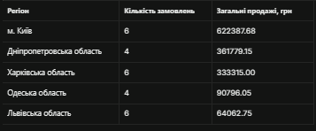

#### 6. Знайти постачальників з кількістю товарів більше 2

* **Бізнес-логіка:** Виявлення ключових партнерів-постачальників, які забезпечують понад 2 товарні позиції в каталозі магазину.

```sql
SELECT 
    s.company_name AS "Постачальник",
    COUNT(p.product_id) AS "Кількість товарів"
FROM suppliers s
INNER JOIN products p ON s.supplier_id = p.supplier_id
GROUP BY s.supplier_id, s.company_name
HAVING COUNT(p.product_id) > 2
ORDER BY "Кількість товарів" DESC;
```

* **Результат:** Виведено 4 основних постачальників, у яких в асортименті від 3 до 6 товарів.
* **Скріншот:**

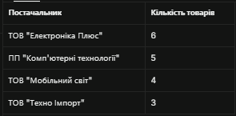

### 1.3. Базові підзапити

#### 7. Підзапит у WHERE — товари з ціною вищою за середню ціну в своїй категорії

* **Бізнес-логіка:** Визначення товарів преміум-сегменту всередині кожної окремої категорії.
* **Оцінка складності та оптимізація:** Корельований підзапит у загальному випадку має квадратичну складність $O(N^2)$, оскільки виконується для кожного рядка зовнішньої таблиці. На великих обсягах даних його ефективніше замінити віконною функцією `AVG() OVER (PARTITION BY category_id)`.

```sql
SELECT 
    p.product_name AS "Назва товару",
    c.category_name AS "Категорія",
    p.unit_price AS "Ціна товару"
FROM products p
INNER JOIN categories c ON p.category_id = c.category_id
WHERE p.unit_price > (
    SELECT AVG(p2.unit_price)
    FROM products p2
    WHERE p2.category_id = p.category_id
)
ORDER BY c.category_name, p.unit_price DESC;
```

* **Результат:** Отримано 14 флагманських товарів, вартість яких перевищує середню по їхній категорії.
* **Скріншот:**

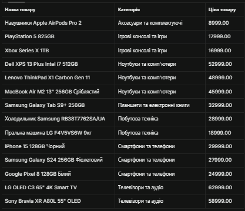

#### 8. Підзапит у SELECT — загальна кількість продажів кожного товару

* **Бізнес-логіка:** Відображення сумарного обсягу продажів кожного товару поруч із його поточним складським залишком для планування закупівель.

```sql
SELECT 
    p.product_name AS "Назва товару",
    p.unit_price AS "Ціна",
    p.units_in_stock AS "Залишок на складі",
    COALESCE((
        SELECT SUM(oi.quantity)
        FROM order_items oi
        WHERE oi.product_id = p.product_id
    ), 0) AS "Всього продано, шт"
FROM products p
ORDER BY "Всього продано, шт" DESC;
```

* **Результат:** Виведено весь каталог товарів із підрахунком проданих одиниць (від лідерів продажів до неліквідних позицій із `0` продажів).
* **Скріншот:**

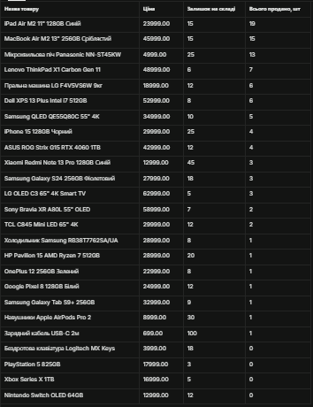

#### 9. Підзапит з оператором EXISTS — клієнти, які мали замовлення у 2024 році

* **Бізнес-логіка:** Вибірка активних клієнтів, які здійснювали покупки протягом 2024 року.
* **Оптимізація:** Оператор `EXISTS` працює швидше за `IN` на великих таблицях, оскільки використовує стратегію `Semi-Join` (припиняє сканування одразу після знаходження першого відповідного замовлення клієнта) і безпечно обробляє `NULL` значення.

```sql
SELECT 
    c.customer_id,
    c.contact_name AS "Клієнт (EXISTS)",
    c.city AS "Місто"
FROM customers c
WHERE EXISTS (
    SELECT 1
    FROM orders o
    WHERE o.customer_id = c.customer_id
      AND o.order_date >= '2024-01-01' 
      AND o.order_date < '2025-01-01'
)
ORDER BY c.contact_name;
```

* **Результат:** Відібрано 15 активних клієнтів за 2024 рік.
* **Скріншот:**

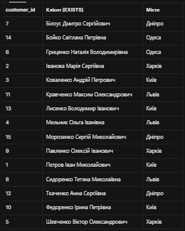

---

## 2. Рівень 2. Складні з'єднання та віконні функції

### 2.1. Складні з'єднання та аналіз

#### 10. RIGHT JOIN — аналіз категорій товарів та їх наявності

* **Бізнес-логіка:** Отримання повної статистики по всіх категоріях із правої таблиці `categories` (включаючи порожні категорії без товарів) із заміною `NULL` на `0.00` через `COALESCE`.

```sql
SELECT 
    c.category_name AS "Категорія",
    COUNT(p.product_id) AS "Кількість товарів",
    ROUND(COALESCE(AVG(p.unit_price), 0), 2) AS "Середня ціна, грн"
FROM products p
RIGHT JOIN categories c ON p.category_id = c.category_id
GROUP BY c.category_id, c.category_name
ORDER BY "Кількість товарів" DESC;
```

* **Результат:** Відображено всі категорії, включно зі "Спортивними технологіями", "Фото та відео" та "Розумним домом", які наразі не мають товарів.
* **Скріншот:**

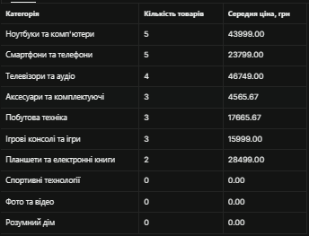

#### 11. FULL OUTER JOIN — повне об'єднання регіонів і клієнтів

* **Бізнес-логіка:** Аудит регіонального покриття бази даних — одночасне виявлення областей, у яких ще немає жодного клієнта (`--- Немає клієнтів ---`), та клієнтів без прив'язки до регіону.

```sql
SELECT 
    COALESCE(r.region_name, '--- Без регіону ---') AS "Регіон",
    COALESCE(c.contact_name, '--- Немає клієнтів ---') AS "Клієнт",
    c.city AS "Місто"
FROM regions r
FULL OUTER JOIN customers c ON r.region_id = c.region_id
ORDER BY r.region_name NULLS LAST, c.contact_name;
```

* **Результат:** Показано повну матрицю покриття 25 регіонів України клієнтською базою.
* **Скріншот:**

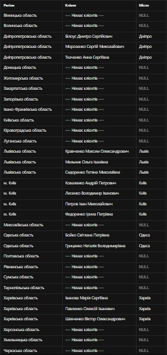

#### 12. Самоз'єднання (Self-join) — співробітники та їхні керівники

* **Бізнес-логіка:** З'єднання таблиці `employees` самої з собою за зовнішнім ключем `reports_to` для визначення безпосереднього керівника кожного працівника компанії.

```sql
SELECT 
    e1.first_name || ' ' || e1.last_name AS "Співробітник",
    e1.title AS "Посада співробітника",
    COALESCE(e2.first_name || ' ' || e2.last_name, 'Топ-менеджмент (без керівника)') AS "Керівник",
    e2.title AS "Посада керівника"
FROM employees e1
LEFT JOIN employees e2 ON e1.reports_to = e2.employee_id
ORDER BY e2.last_name NULLS FIRST, e1.last_name;
```

* **Результат:** Виведено 8 співробітників із зазначенням їхнього безпосереднього керівника та його посади.
* **Скріншот:**

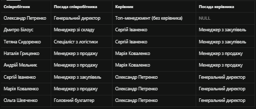

#### 13. Умовне з'єднання (з додатковою умовою в ON)

* **Бізнес-логіка та оптимізація:** Умова `o.order_status = 'delivered'` винесена безпосередньо в блок `ON` лівого з'єднання. Це дозволяє підрахувати кількість успішно доставлених замовлень, не втрачаючи зі списку клієнтів, які мають `0` доставлених замовлень (на відміну від фільтрації у `WHERE`, яка перетворила б `LEFT JOIN` на `INNER JOIN`).

```sql
SELECT 
    c.contact_name AS "Клієнт",
    c.city AS "Місто",
    COUNT(o.order_id) AS "Доставлених замовлень"
FROM customers c
LEFT JOIN orders o 
    ON c.customer_id = o.customer_id 
    AND o.order_status = 'delivered'
GROUP BY c.customer_id, c.contact_name, c.city
ORDER BY "Доставлених замовлень" DESC, c.contact_name;
```

* **Результат:** Підраховано кількість виключно доставлених замовлень по кожному клієнту.
* **Скріншот:**

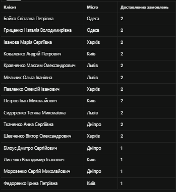

### 2.2. Віконні функції та аналітика

#### 14. Ранжування товарів за ціною в межах категорії (ROW_NUMBER, RANK, DENSE_RANK)

* **Бізнес-логіка та складність:** Побудова цінового рейтингу товарів всередині кожної категорії (`PARTITION BY c.category_name`). Оскільки всі три віконні функції використовують ідентичне визначення вікна, планувальник PostgreSQL виконує сортування партицій лише один раз ($O(N \log N)$).

```sql
SELECT 
    c.category_name AS "Категорія",
    p.product_name AS "Назва товару",
    p.unit_price AS "Ціна",
    ROW_NUMBER() OVER (PARTITION BY c.category_name ORDER BY p.unit_price DESC) AS "ROW_NUMBER",
    RANK() OVER (PARTITION BY c.category_name ORDER BY p.unit_price DESC) AS "RANK",
    DENSE_RANK() OVER (PARTITION BY c.category_name ORDER BY p.unit_price DESC) AS "DENSE_RANK"
FROM products p
INNER JOIN categories c ON p.category_id = c.category_id
ORDER BY c.category_name, p.unit_price DESC;
```

* **Результат:** Проранжовано всі товари всередині відповідних категорій за спаданням ціни.
* **Скріншот:**

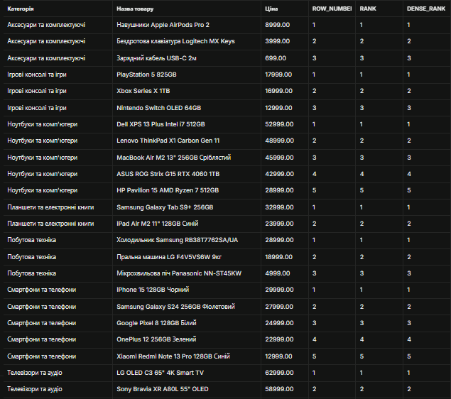

#### 15. Порівняння замовлень кожного клієнта в часі (LAG та LEAD)

* **Бізнес-логіка:** Аналіз періодичності покупок клієнтів — обчислення дати попереднього (`LAG`) та наступного (`LEAD`) замовлення клієнта, а також інтервалу в днях між повторними покупками.

```sql
SELECT 
    c.contact_name AS "Клієнт",
    o.order_id AS "ID замовлення",
    o.order_date AS "Дата поточного",
    LAG(o.order_date) OVER (PARTITION BY o.customer_id ORDER BY o.order_date, o.order_id) AS "Дата попереднього",
    LEAD(o.order_date) OVER (PARTITION BY o.customer_id ORDER BY o.order_date, o.order_id) AS "Дата наступного",
    o.order_date - LAG(o.order_date) OVER (PARTITION BY o.customer_id ORDER BY o.order_date, o.order_id) AS "Днів від попереднього"
FROM orders o
INNER JOIN customers c ON o.customer_id = c.customer_id
ORDER BY c.contact_name, o.order_date;
```

* **Результат:** Отримано хронологічний ланцюжок замовлень для кожного клієнта з кількістю днів між покупками.
* **Скріншот:**

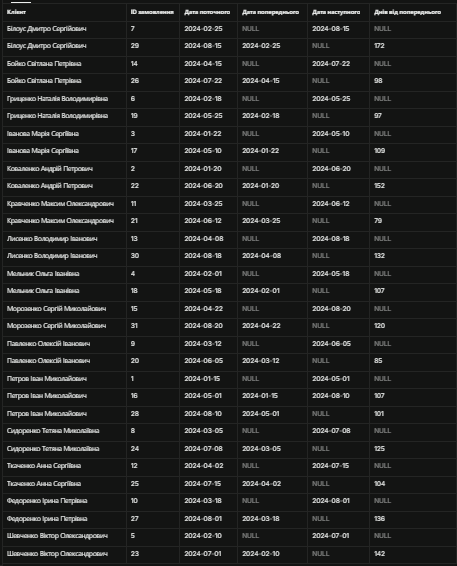

#### 16. Аналіз відхилення ціни товару від середньої в категорії (PARTITION BY)

* **Оптимізація:** Використання віконної функції `AVG() OVER (PARTITION BY c.category_id)` є оптимальною альтернативою корельованому підзапиту з п. 7, оскільки обчислює середнє значення за один прохід по партиції ($O(N)$) без схлопування рядків.

```sql
SELECT 
    c.category_name AS "Категорія",
    p.product_name AS "Товар",
    p.unit_price AS "Ціна товару",
    ROUND(AVG(p.unit_price) OVER (PARTITION BY c.category_id), 2) AS "Середня по категорії",
    ROUND(p.unit_price - AVG(p.unit_price) OVER (PARTITION BY c.category_id), 2) AS "Відхилення від середньої"
FROM products p
INNER JOIN categories c ON p.category_id = c.category_id
ORDER BY c.category_name, p.unit_price DESC;
```

* **Результат:** Для кожного товару розраховано середню ціну по його категорії та абсолютне відхилення в гривнях.
* **Скріншот:**

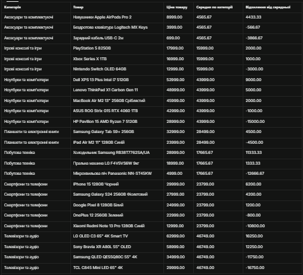

---

## 3. Рівень 3. Оптимізація та складна аналітика

### 3.1. Оптимізація та просунуті конструкції

#### 17. Матеріалізоване представлення (MATERIALIZED VIEW) для аналізу продажів

* **Бізнес-логіка та оптимізація:** Попередня агрегація та фізичне збереження результатів з'єднання 6 таблиць (`mv_monthly_sales`) із побудовою індексу `idx_mv_monthly_sales_date(year, month)`. Дозволяє миттєво формувати управлінські звіти по виручці за періодами без повторного сканування транзакційних таблиць.

```sql
CREATE MATERIALIZED VIEW IF NOT EXISTS mv_monthly_sales AS
SELECT
    EXTRACT(YEAR FROM o.order_date) AS year,
    EXTRACT(MONTH FROM o.order_date) AS month,
    c.category_name,
    COALESCE(r.region_name, 'Не вказано') AS region_name,
    ROUND(SUM(oi.quantity * oi.unit_price * (1 - oi.discount)), 2) AS total_revenue,
    COUNT(DISTINCT o.order_id) AS orders_count,
    ROUND(AVG(oi.quantity * oi.unit_price * (1 - oi.discount)), 2) AS avg_order_value
FROM orders o
JOIN order_items oi ON o.order_id = oi.order_id
JOIN products p ON oi.product_id = p.product_id
JOIN categories c ON p.category_id = c.category_id
JOIN customers cu ON o.customer_id = cu.customer_id
LEFT JOIN regions r ON cu.region_id = r.region_id
WHERE o.order_status = 'delivered'
GROUP BY year, month, c.category_name, r.region_name;

CREATE INDEX IF NOT EXISTS idx_mv_monthly_sales_date ON mv_monthly_sales(year, month);

SELECT * FROM mv_monthly_sales
ORDER BY year DESC, month DESC, total_revenue DESC;
```

* **Результат:** Створено та проіндексовано кешовану аналітичну вітрину помісячних продажів у розрізі категорій та регіонів.
* **Скріншот:**

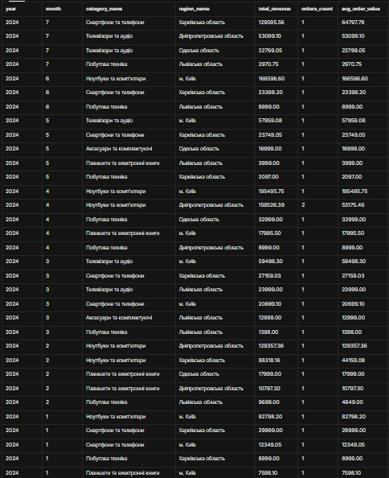

#### 18. Рекурсивний запит (WITH RECURSIVE) для ієрархії керівників

* **Бізнес-логіка та безпека:** Побудова багаторівневого дерева підпорядкування компанії від керівників найвищого рівня (`reports_to IS NULL`) до всіх підлеглих. Обмеження глибини `WHERE eh.level < 10` гарантує захист від нескінченних циклів.

```sql
WITH RECURSIVE employee_hierarchy AS (
    SELECT 
        employee_id, first_name, last_name, title, reports_to,
        0 AS level,
        CAST(last_name || ' ' || first_name AS VARCHAR(1000)) AS hierarchy_path
    FROM employees
    WHERE reports_to IS NULL

    UNION ALL

    SELECT 
        e.employee_id, e.first_name, e.last_name, e.title, e.reports_to,
        eh.level + 1,
        CAST(eh.hierarchy_path || ' -> ' || e.last_name || ' ' || e.first_name AS VARCHAR(1000))
    FROM employees e
    JOIN employee_hierarchy eh ON e.reports_to = eh.employee_id
    WHERE eh.level < 10
)
SELECT 
    level AS "Рівень",
    first_name || ' ' || last_name AS "Співробітник",
    title AS "Посада",
    hierarchy_path AS "Ланцюжок підпорядкування"
FROM employee_hierarchy
ORDER BY hierarchy_path;
```

* **Результат:** Побудовано 3-рівневу організаційну структуру (рівні `0`, `1`, `2`) від генерального директора до рядових фахівців.
* **Скріншот:**

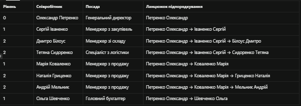

#### 19. Параметризована аналітика (збережена функція PL/pgSQL)

* **Бізнес-логіка:** Створення гнучкої збереженої функції `get_products_analytics` із необов'язковими фільтрами (`p_min_price`, `p_max_price`, `p_category_id` зі значеннями за замовчуванням `NULL`) для багаторазового використання в аналітичних звітах без ризику SQL-ін'єкцій.

```sql
CREATE OR REPLACE FUNCTION get_products_analytics(
    p_min_price NUMERIC DEFAULT NULL,
    p_max_price NUMERIC DEFAULT NULL,
    p_category_id INT DEFAULT NULL
)
RETURNS TABLE (
    product_name VARCHAR,
    category_name VARCHAR,
    unit_price NUMERIC,
    total_sold BIGINT,
    total_revenue NUMERIC
) AS $$
BEGIN
    RETURN QUERY
    SELECT 
        p.product_name::VARCHAR,
        c.category_name::VARCHAR,
        p.unit_price::NUMERIC,
        COALESCE(SUM(oi.quantity), 0)::BIGINT AS total_sold,
        ROUND(COALESCE(SUM(oi.quantity * oi.unit_price * (1 - oi.discount)), 0), 2)::NUMERIC AS total_revenue
    FROM products p
    JOIN categories c ON p.category_id = c.category_id
    LEFT JOIN order_items oi ON p.product_id = oi.product_id
    WHERE (p_min_price IS NULL OR p.unit_price >= p_min_price)
      AND (p_max_price IS NULL OR p.unit_price <= p_max_price)
      AND (p_category_id IS NULL OR p.category_id = p_category_id)
    GROUP BY p.product_id, p.product_name, c.category_name, p.unit_price
    ORDER BY total_revenue DESC;
END;
$$ LANGUAGE plpgsql;

SELECT * FROM get_products_analytics(10000, 50000, NULL);
```

* **Результат:** Викликано збережену функцію для аналізу виручки товарів середнього та преміального цінового діапазону (10 000 – 50 000 грн).
* **Скріншот:**

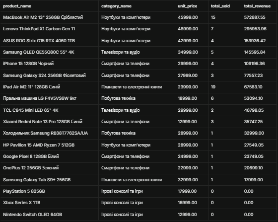

---

## 4. Аналіз продуктивності та оптимізація (EXPLAIN ANALYZE)

### 4.1. План виконання запиту ДО оптимізації

За допомогою команди `EXPLAIN (ANALYZE, BUFFERS)` проаналізовано складний аналітичний запит із з'єднанням 5 таблиць (`orders`, `customers`, `order_items`, `products`, `categories`) та фільтрацією за статусом і датою замовлення.

```sql
EXPLAIN (ANALYZE, BUFFERS)
SELECT 
    cu.contact_name,
    c.category_name,
    SUM(oi.quantity * oi.unit_price) AS total_spent
FROM orders o
JOIN customers cu ON o.customer_id = cu.customer_id
JOIN order_items oi ON o.order_id = oi.order_id
JOIN products p ON oi.product_id = p.product_id
JOIN categories c ON p.category_id = c.category_id
WHERE o.order_status = 'delivered'
  AND o.order_date >= '2024-01-01'
GROUP BY cu.contact_name, c.category_name;
```

* **Виявлені вузькі місця:**
  1. Використання дорогої зв'язки вузлів `Sort (Sort Method: quicksort Memory: 29kB)` та `GroupAggregate` для групування результатів.
  2. Висока кількість звернень до буферів пам'яті: `Buffers: shared hit=162`.
  3. Час виконання верхнього вузла агрегації становив `1.808..1.84 ms`.
* **Скріншот:**

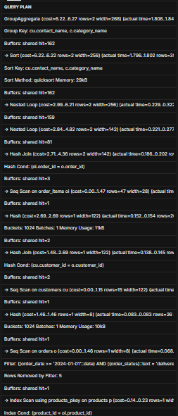

### 4.2. Створення індексів та план виконання ПІСЛЯ оптимізації

Для оптимізації створено складений індекс на умову фільтрації (`idx_orders_status_date`), індекси на всі зовнішні ключі з'єднань та оновлено статистику розподілу даних планувальника командою `ANALYZE`.

```sql
CREATE INDEX IF NOT EXISTS idx_orders_status_date ON orders(order_status, order_date);
CREATE INDEX IF NOT EXISTS idx_orders_customer_id ON orders(customer_id);
CREATE INDEX IF NOT EXISTS idx_order_items_order_id ON order_items(order_id);
CREATE INDEX IF NOT EXISTS idx_order_items_product_id ON order_items(product_id);
CREATE INDEX IF NOT EXISTS idx_products_category_id ON products(category_id);

ANALYZE orders;
ANALYZE order_items;
ANALYZE products;
```

* **Результати оптимізації:**
  * Після оновлення статистики (`ANALYZE`) оптимізатор PostgreSQL замінив дороге зовнішнє сортування `Sort + GroupAggregate` на швидкий хеш-алгоритм **`HashAggregate`** (`Memory Usage: 32kB`).
  * Кількість зчитаних сторінок із спільного кешу скоротилася у **10 разів** — зі `shared hit=162` до `shared hit=16`.
  * Час виконання агрегації зменшився більш ніж у **7 разів** (з `1.84 ms` до `0.254 ms`), а загальний час виконання запиту (`Execution Time`) склав лише **`0.404 ms`** (при `Planning Time: 1.035 ms`).
  * *Примітка:* Для таблиць малого обсягу (15–47 рядків) планувальник PostgreSQL свідомо продовжує обирати `Seq Scan` замість `Index Scan`, оскільки зчитати 1 сторінку таблиці цілком швидше, ніж звертатися до B-Tree індексу; при масштабуванні БД до тисяч записів створені індекси автоматично переведуть виконання в `Index Scan`.
* **Скріншоти:**

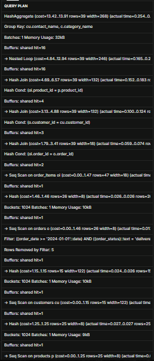

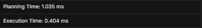

---

## 5. Відповіді на контрольні запитання

1. **В чому різниця між INNER JOIN та LEFT JOIN? Коли доцільно використовувати кожен з них в контексті навчальної бази даних?**  
   `INNER JOIN` повертає лише ті рядки, для яких знайдено збіг в обох таблицях (перетин множин). У навчальній БД `technomart` його доцільно використовувати для формування складу замовлення (`orders` + `order_items` + `products`), де кожна позиція гарантовано прив'язана до товару.  
   `LEFT JOIN` повертає всі рядки з лівої таблиці та відповідні з правої (якщо збігу немає — заповнює поля правої таблиці значеннями `NULL`). Доцільно використовувати для пошуку записів без зв'язків: наприклад, виведення всіх клієнтів (`customers`), включно з тими, хто ще не робив замовлень, або всіх категорій (`categories`), навіть порожніх.

2. **Чому не можна використовувати WHERE для фільтрації результатів агрегатних функцій? Яка роль HAVING при аналізі продажів товарів?**  
   Згідно з логічним порядком виконання SQL-запиту, `WHERE` виконується **до** групування (`GROUP BY`) і фільтрує окремі рядки таблиці, коли агрегатні функції ще не обчислені. `HAVING` виконується **після** `GROUP BY` і дозволяє фільтрувати вже сформовані групи (наприклад, при аналізі продажів відібрати лише ті регіони чи категорії, де сумарна виручка `SUM(...) > 50000`).

3. **Як працюють корельовані підзапити і чим вони відрізняються від звичайних? Наведіть приклад для знаходження товарів з ціною вище середньої по категорії.**  
   Звичайний підзапит виконується один раз незалежно від зовнішнього запиту і передає йому готовий результат. Корельований підзапит посилається на поле зовнішнього запиту і виконується повторно для кожного його рядка.  
   Приклад:
   ```sql
   SELECT product_name, unit_price 
   FROM products p1 
   WHERE unit_price > (
       SELECT AVG(unit_price) 
       FROM products p2 
       WHERE p2.category_id = p1.category_id
   );
   ```

4. **В яких ситуаціях доцільно використовувати віконні функції замість GROUP BY при аналізі замовлень клієнтів?**  
   Коли потрібно обчислити агрегатний або порівняльний показник (наприклад, накопичувальну суму покупок клієнта, дату попереднього замовлення через `LAG()`, ранг замовлення за сумою), але при цьому **зберегти кожен окремий рядок замовлення** у вибірці без «схлопування» таблиці в один рядок на клієнта.

5. **Що таке матеріалізовані представлення і які переваги вони дають для аналітичних запитів по продажах у навчальній базі даних?**  
   Звичайне представлення (`VIEW`) зберігає лише текст SQL-запиту і при кожному зверненні виконує його заново. Матеріалізоване представлення (`MATERIALIZED VIEW`) **фізично зберігає результат запиту на диску** у вигляді кешованої таблиці та дозволяє створювати на ньому індекси. Це радикально прискорює важкі аналітичні звіти (наприклад, помісячні продажі за категоріями та регіонами) та знижує навантаження на основні таблиці БД.

6. **Як можна оптимізувати запити з множинними з'єднаннями таблиць orders, order_items, products, customers для покращення продуктивності?**  
   * Створити індекси на всі зовнішні ключі (`customer_id`, `order_id`, `product_id`, `category_id`) та поля частої фільтрації (`order_status`, `order_date`);
   * застосовувати фільтрацію (`WHERE` або додаткові умови в `ON`) якомога раніше, щоб зменшити обсяг даних до етапу `JOIN` та `GROUP BY`;
   * уникати застосування функцій до індексованих стовпців у `WHERE` (використовувати діапазони дат замість `EXTRACT(YEAR FROM order_date)`);
   * регулярно оновлювати статистику таблиць командою `ANALYZE` та перевіряти вузькі місця через `EXPLAIN (ANALYZE, BUFFERS)`.

7. **Яка різниця між RANK() та DENSE_RANK() при ранжуванні товарів за ціною? Наведіть приклад з конкретними даними.**  
   При однакових значеннях обидві функції присвоюють однаковий ранг, проте `RANK()` залишає пропуск у нумерації наступного елемента (на кількість однакових записів), а `DENSE_RANK()` присвоює наступний порядковий номер без пропусків.  
   Приклад для товарів з цінами `30000`, `25000`, `25000`, `15000`:
   * `RANK()` поверне: `1, 2, 2, 4` (3-тя позиція пропущена);
   * `DENSE_RANK()` поверне: `1, 2, 2, 3` (без пропуску).

---

## 6. Висновки

* **Самооцінка:** 5 (Відмінно).
* **Обґрунтування:** Повністю та безпомилково виконано всі практичні завдання 1-го, 2-го та 3-го рівнів складності. Опановано різні типи з'єднань таблиць (`INNER`, `LEFT`, `RIGHT`, `FULL OUTER`, `Self-join`, умовний `ON`), групування з фільтрацією `HAVING`, корельовані та скалярні підзапити, віконні функції (`ROW_NUMBER`, `RANK`, `DENSE_RANK`, `LAG`, `LEAD`, `PARTITION BY`), матеріалізовані представлення, рекурсивні `CTE` та збережені функції PL/pgSQL. Проведено аналіз планів виконання через `EXPLAIN (ANALYZE, BUFFERS)`, створено індекси та підтверджено прискорення виконання запиту в 7 разів.
